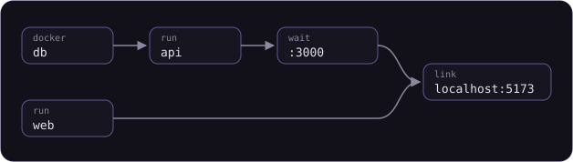

<h1 align="center">
  <picture>
    <source media="(prefers-color-scheme: dark)" srcset="website/public/wordmark-dark.svg" />
    
  </picture><br />
  <sub><sub><i>as in will-o'-the-wisp, the little light that leads the way</i></sub></sub>
</h1>

<p align="center">
  <a href="https://github.com/phrp720/wisp/releases/latest"></a>
  <a href="https://www.npmjs.com/package/@squaredasher/wisp"></a>
  <a href="https://www.npmjs.com/package/@squaredasher/wisp"></a>
  <a href="https://github.com/phrp720/wisp/actions/workflows/ci.yml"></a>
  <a href="LICENSE"></a>
</p>

<p align="center">
  <b>Pipelines for your own machines.</b><br />
  Your dev stack, checks, deploys and backups, run by name from whatever folder you're in.<br />
  Steps run side by side or in order, and Wisp keeps track of everything they start.
</p>

<p align="center">
  
</p>

<p align="center">
  <a href="https://willowisp.dev/docs/getting-started">Get started</a> ·
  <a href="https://willowisp.dev/docs/use-cases">Use cases</a> ·
  <a href="https://willowisp.dev/docs/cli">CLI</a> ·
  <a href="https://willowisp.dev/docs/reference">File reference</a> ·
  <a href="https://willowisp.dev/docs/agents">For AI agents</a>
</p>

## What it is

A **pipeline** is a name and its steps, in a `.wisp.json` next to your code or in a personal
workspace. Steps start together unless they say what they wait for:

<p align="center">
  
</p>

```json
{
  "name": "Acme",
  "pipelines": [
    {
      "label": "Dev",
      "steps": [
        { "compose": "compose.yaml", "services": ["postgres"], "label": "db" },
        { "run": "pnpm dev", "cwd": "apps/api", "label": "api", "after": "db" },
        { "run": "pnpm dev", "cwd": "apps/web", "label": "web" },
        { "wait": "http://localhost:3000", "label": "up", "after": "api" },
        { "url": "http://localhost:5173", "after": ["up", "web"] }
      ]
    }
  ]
}
```

`wisp acme dev` runs it from any folder; inside the project, `wisp dev` is enough. A step runs
a command, starts Docker services, waits for a port or a website, runs another pipeline, or
opens a link, a folder, a file or an app. `wisp init` drafts pipelines from what the project
already has, and the dashboard edits them through forms.

Then Wisp:

- **Knows what it started.** Servers run in the background, never twice, each with its log.
  `wisp ps` lists them, `wisp logs api -f` follows one, and `wisp down dev` stops everything
  the pipeline started, child processes included. A crashed server can restart on its own.
- **Keeps every run, like CI.** Each run is numbered, with its commit and each step's output.
  The first failure stops the run, `--retry` runs only what failed, and a `timeout` stops a
  step that hangs.
- **Asks when it matters.** A deploy can ask *where?* and *are you sure?* A script answers
  with `--input env=production --yes`.
- **Tells you when it fails.** A cron run that breaks shows a notification, or posts to
  Slack, Discord or ntfy.
- **Is safe with cloned repos.** A file's commands run only after you've read them and run
  `wisp trust`. Any change, a `git pull` included, asks again.
- **Works with agents.** Every command takes `--json`, nothing prompts without a terminal,
  and `wisp help agents` prints the whole reference. An agent can't approve its own commands.

<p align="center">
  
</p>

## Install

```bash
curl -fsSL https://willowisp.dev/install.sh | sh     # macOS and Linux, no Node needed
npm install -g @squaredasher/wisp                     # anywhere, with Node 22.12+
```

Windows without Node: [Releases](https://github.com/phrp720/wisp/releases) has a zip.
`wisp completion --install` adds tab completion for zsh, bash and fish.

## Start

```bash
cd ~/dev/acme
wisp init      # suggests pipelines from what the project has; keep the ones you want
wisp trust     # read what it would run, then allow it
wisp acme dev  # run one, from any folder
wisp           # the dashboard
```

## Development

```bash
pnpm install
pnpm test && pnpm typecheck
pnpm build             # cli/dist
pnpm website:dev       # the website, at http://localhost:5173
```

`cli/` is Wisp (`src/core`: the format, trust and running; `src/cli` and `src/tui`: the
command and its dashboard). `website/` is the site and docs. Start with
[CONTRIBUTING.md](CONTRIBUTING.md).

## License

[MIT](LICENSE)
