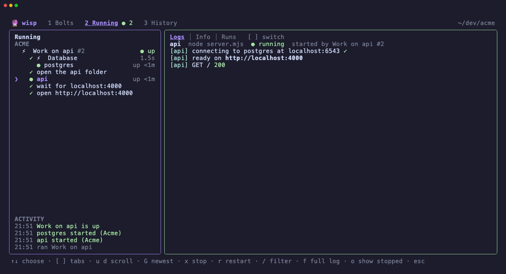

<h1 align="center">
  <picture>
    <source media="(prefers-color-scheme: dark)" srcset="website/public/wordmark-dark.svg" />
    
  </picture><br />
  <sub><sub><i>as in will-o'-the-wisp, the little light that leads the way</i></sub></sub>
</h1>

<p align="center">
  <a href="https://github.com/phrp720/wisp/releases/latest"></a>
  <a href="https://www.npmjs.com/package/@squaredasher/wisp"></a>
  <a href="https://www.npmjs.com/package/@squaredasher/wisp"></a>
  <a href="https://github.com/phrp720/wisp/actions/workflows/ci.yml"></a>
  <a href="LICENSE"></a>
</p>

<p align="center">
  <b>Start any project from anywhere, with one word.</b><br />
  The database, the server, your editor in the right folder, the page in your browser:<br />
  described once, brought up with <code>wisp api</code> from any terminal.<br />
  Your workflows too: checks, builds and releases, kept like CI runs.
</p>

<p align="center">
  
</p>

<p align="center">
  <a href="https://willowisp.dev/docs/getting-started">Docs</a> ·
  <a href="https://willowisp.dev/docs/commands">Commands</a> ·
  <a href="https://willowisp.dev/docs/reference">File reference</a> ·
  <a href="https://willowisp.dev/docs/questions">Questions</a> ·
  <a href="https://willowisp.dev/docs/agents">For AI agents</a>
</p>

## Install

```bash
curl -fsSL https://willowisp.dev/install.sh | sh     # macOS and Linux, no Node needed
npm install -g @squaredasher/wisp                     # anywhere, with Node 22.12+
wisp completion --install                             # optional: tab completion
```

Windows without Node: [Releases](https://github.com/phrp720/wisp/releases) has a zip.

## Quick start

```bash
cd ~/dev/acme
wisp init     # suggests bolts from what the project has; keep the ones you want
wisp trust    # allow its commands, after reading them
wisp api      # run the "api" bolt, from any folder: any distinctive word of its name
wisp          # the dashboard
```

`wisp init` reads package.json scripts, compose files, Django, FastAPI, Gradle, Maven, Go,
Rust, Rails, Laravel, .NET, Makefiles and [more](https://willowisp.dev/docs/file#wisp-init).

<p align="center">
  
</p>

## The dashboard

`wisp` opens a dashboard of all your projects, right in your terminal: run a bolt with `⏎`,
watch what it started on **Running**, look back on **History**. Add and edit bolts through
forms; no JSON to touch. It works the same over SSH and in tmux.

<p align="center">
  
</p>

## A bolt

A named list of things to start, in order. It lives in a `.wisp.json` next to your code, so
the whole team has it:

```json
{
  "name": "Acme",
  "bolts": [
    {
      "label": "Work on api",
      "targets": [
        { "compose": "compose.yaml", "services": ["postgres"] },
        { "folder": "apps/api" },
        { "run": "pnpm dev", "cwd": "apps/api" },
        { "wait": "http://localhost:3000" },
        { "url": "http://localhost:3000" }
      ]
    }
  ]
}
```

Steps can run commands, start Docker services, wait for a port or a website, run another
bolt first, and open links, folders, files and apps. Every field is in the
[File reference](https://willowisp.dev/docs/reference).

## Workflows

Checks, builds and releases run as workflows: mark a bolt `"job": true` and it runs step by
step, stopping at the first failure. Every run is kept like a CI run, with its commit and each
step's output; `--retry` runs only what failed. `wisp hook pre-push check` runs one before
every push.

<p align="center">
  
</p>

## What's running

Servers run in the background, each with its live output in the Running tab, and keep
running when you close Wisp. `wisp ps` lists them, `wisp logs api -f` follows one, and
`wisp down api` stops everything a bolt started, child processes included.

<p align="center">
  
</p>

Rather have a terminal window per command, or a tmux session? Choose it in Settings (`s`).

## Trust

A cloned repository could put anything in its `.wisp.json`, so **nothing in it that runs code
starts until you've read it and allowed it** with `wisp trust`. Any change, a `git pull`
included, asks again. AI agents can write and run bolts, but can't approve their own.

## Development

```bash
pnpm install
pnpm test && pnpm typecheck
pnpm build             # cli/dist
pnpm website:dev       # the website, at http://localhost:5173
```

`cli/` is Wisp (`src/core`: the format, trust and running; `src/cli` and `src/tui`: the
command and its dashboard). `website/` is the site and docs (VitePress, on Cloudflare).
Want to help? Start with [CONTRIBUTING.md](CONTRIBUTING.md).

## License

[MIT](LICENSE)
